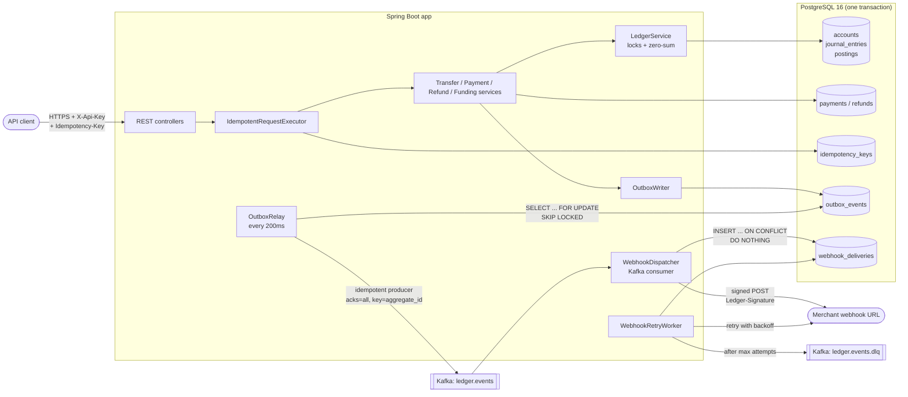
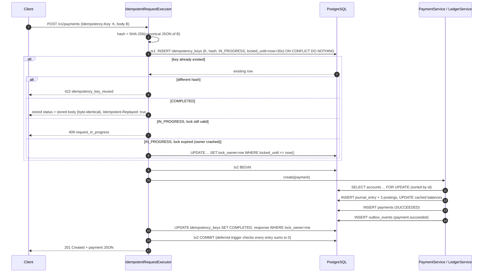

# Idempotent Payments Ledger Service


A **double-entry ledger service** (Java 21, Spring Boot 3.3, PostgreSQL 16, Kafka) with a REST API for
accounts, fundings, transfers, payments and refunds, modelled on how payment companies such as Stripe record
money movement. Every money movement is a journal entry whose postings sum to zero. Every POST is
**idempotent** (a retried request never double-charges). Parallel transfers are **safe under concurrency**,
using ordered row locks, no deadlocks, and no balance drift. Every movement emits an event **exactly once into the
outbox** (the transactional outbox pattern), is relayed to Kafka **at least once**, and reaches merchants as
**HMAC-signed webhooks** with exponential-backoff retries and a dead-letter queue.

> Replace `<your-github-user>` in the badge URL after pushing the repo to GitHub.

## Documentation map

| Document | What's inside |
|---|---|
| [docs/RUNNING.md](docs/RUNNING.md) | Step-by-step: install prerequisites, start with Docker Compose, run locally, run tests, load test, troubleshooting |
| [docs/ARCHITECTURE.md](docs/ARCHITECTURE.md) | All diagrams (components, ER model, sequences, state machines) and every design decision explained |
| [docs/API.md](docs/API.md) | Every endpoint with `curl` examples, request/response bodies and error codes |
| [docs/TESTING.md](docs/TESTING.md) | Test strategy, what each test proves, how to read the coverage and concurrency reports |
| [docs/JAVA_FOR_PYTHON_DEVELOPERS.md](docs/JAVA_FOR_PYTHON_DEVELOPERS.md) | Every Java/Spring concept used here, mapped to its Django/FastAPI/Celery equivalent |
| [docs/INTERVIEW_PREP.md](docs/INTERVIEW_PREP.md) | Resume bullets (to fill from real numbers) and 15 interview questions with model answers |

## Architecture



## Payment request, including the idempotency check



## Design decisions (summary — full reasoning in [ARCHITECTURE.md](docs/ARCHITECTURE.md))

| Decision | Why | Rejected alternative |
|---|---|---|
| **Double-entry, append-only postings** (debit `+`, credit `−`, entry sums to 0) | Money can't appear or vanish; full audit trail; corrections are reversing entries | Single "balance" column updated in place: no history, drift is undetectable |
| **Cached balance on the account row**, updated in the same transaction | O(1) balance reads; reconciliation proves cache == `SUM(postings)` | Summing postings on every read: gets slower as the table grows |
| **Zero-sum checked twice**: `LedgerService` + a deferred PostgreSQL constraint trigger | Service gives good errors; the trigger makes an unbalanced commit impossible even from buggy code or manual SQL | Service-only check: one bug away from corrupt books |
| **Idempotency keys with an `IN_PROGRESS` lock row and completion in the business transaction** | No state where money moved but the key isn't completed; concurrent duplicates get 409; crashed requests can be taken over | Caching responses after commit (a crash between commit and cache = double charge on retry) |
| **Pessimistic `FOR UPDATE` locks for balances, in ascending account-id order** | Hot rows: queue writers instead of failing them; global lock order makes deadlock cycles impossible | Optimistic locking for balances: constant version conflicts under contention |
| **Optimistic `@Version` for metadata** (account status, payment `refunded_minor`) | Rare, low-contention updates; no locks held; any concurrent change is detected | Locking every metadata read |
| **Retry whole transaction on deadlock/serialization/lock-timeout (3×, jittered)** | Safety net for transient DB conflicts, then 409 so the client retries | Surfacing raw 500s |
| **Transactional outbox + relay with `SKIP LOCKED`** | Event row commits atomically with the money movement; multiple relay instances can run in parallel | Dual write (DB commit, then Kafka send): crash in between loses or invents events |
| **At-least-once delivery + consumer dedupe on event id** | Exactly-once across DB+Kafka+HTTP is not achievable; dedupe makes the effect exactly-once | Pretending the idempotent producer gives end-to-end exactly-once |
| **HMAC-SHA256 webhook signatures over `timestamp.body`** | Authenticity + integrity + replay protection (5-minute tolerance), constant-time compare | Shared static token in a header: replayable, no integrity |

## Quick start

Full instructions, including installing Java and Docker, are in **[docs/RUNNING.md](docs/RUNNING.md)**.

```bash
# 1. One-time: generate the Gradle wrapper (needs Gradle installed: brew install gradle)
gradle wrapper --gradle-version 8.10.2

# 2. Start PostgreSQL, Kafka, the app and a webhook echo server
docker compose up --build

# 3. Try it
curl -s localhost:8080/actuator/health
./scripts/demo.sh            # end-to-end demo (needs jq)
open http://localhost:8080/swagger-ui.html

# 4. Run the whole test suite (Docker must be running; Testcontainers starts Postgres + Kafka)
./gradlew test
```

## Example requests

The default development API key is `sk_test_local_dev_key`. There are more examples in [docs/API.md](docs/API.md).

```bash
KEY=sk_test_local_dev_key
# create a customer wallet
curl -s -X POST localhost:8080/v1/accounts -H "X-Api-Key: $KEY" -H "Idempotency-Key: $(uuidgen)" \
  -H "Content-Type: application/json" \
  -d '{"code":"customer_funds:c_123","type":"LIABILITY","currency":"USD"}'
# fund it with $100.00
curl -s -X POST localhost:8080/v1/fundings -H "X-Api-Key: $KEY" -H "Idempotency-Key: $(uuidgen)" \
  -H "Content-Type: application/json" -d '{"account_id":"<id>","amount_minor":10000,"currency":"USD"}'
# pay a merchant $10.00 (merchant_balance:m_456 must exist)
curl -s -X POST localhost:8080/v1/payments -H "X-Api-Key: $KEY" -H "Idempotency-Key: order-42" \
  -H "Content-Type: application/json" \
  -d '{"customer_id":"c_123","merchant_id":"m_456","amount_minor":1000,"currency":"USD"}'
```

## Measured results

> These numbers must come from **your** runs. Nothing below is estimated. Fill each row in after you run the
> command next to it (see [docs/TESTING.md](docs/TESTING.md#recording-results)).

| Metric | How to measure | Result |
|---|---|---|
| Concurrency test: 1,000 parallel transfers, 50 threads, 10 accounts | `./gradlew test --tests '*TransferConcurrencyIntegrationTest'` then `cat build/concurrency-test-result.txt` | _not yet measured_ |
| Deadlocks / 409s / 500s leaked during that test | same file (`statuses=`) | _not yet measured_ |
| k6 throughput (transfers/s) and p95 latency | `docker run ... grafana/k6 run - < loadtest/k6-transfers.js` | _not yet measured_ |
| JaCoCo line coverage | `./gradlew test` then open `build/reports/jacoco/test/html/index.html` | _not yet measured_ |
| Number of tests | `build/reports/tests/test/index.html` | _not yet measured_ |

Hardware used for the numbers above: _fill in (CPU, RAM, Docker Desktop resources)_.

## Known limitations and next steps

- **Single currency per transaction**; there is no FX. Next step: FX conversion entries through a currency-pair clearing account.
- **API keys come from config.** Next step: hashed keys in the DB, rotation, and per-key scopes (for example, merchant keys only see their own payments and events).
- **Webhook secrets are stored in plain text.** Next step: envelope-encrypt them with a KMS, and support secret rotation (the verifier already accepts multiple `v1=` signatures).
- **Outbox ordering is per aggregate only, and best-effort under failures.** If event 1 fails to send and event 2 succeeds in the same batch, they can reach Kafka out of order. Next step: stop the batch at the first failure per key, or include a per-aggregate sequence number.
- **The outbox and delivery tables grow forever.** Next step: archive or partition published rows by month.
- **Payouts and reversals are not exposed through the API** (`REVERSAL` exists as an entry type). Next step: `POST /v1/payouts` (merchant → external_settlement) and admin reversal entries.
- **Hot accounts** (for example, one `platform_fees:USD` row touched by every payment) serialize on a single row lock. Next step: shard the hot account into N sub-accounts and sum them on read.
- **There is no authorization model per merchant.** Any valid API key can read any event or payment.
