# Architecture and design decisions

- [1. System context](#1-system-context)
- [2. Component view (packages)](#2-component-view-packages)
- [3. Data model (ER diagram)](#3-data-model)
- [4. Double-entry accounting](#4-double-entry-accounting)
- [5. Money flows with exact postings](#5-money-flows-with-exact-postings)
- [6. Idempotency](#6-idempotency)
- [7. Concurrency: pessimistic vs optimistic locking, deadlock avoidance, retries](#7-concurrency)
- [8. Transactional outbox and Kafka](#8-transactional-outbox-and-kafka)
- [9. Webhooks: signing, retries, DLQ](#9-webhooks)
- [10. Reconciliation](#10-reconciliation)
- [11. Transaction boundaries, all in one picture](#11-transaction-boundaries)
- [12. Error model](#12-error-model)
- [13. Deployment view](#13-deployment-view)
- [14. Deliberate deviations from the original spec](#14-deliberate-deviations-from-the-original-spec)

---

## 1. System context

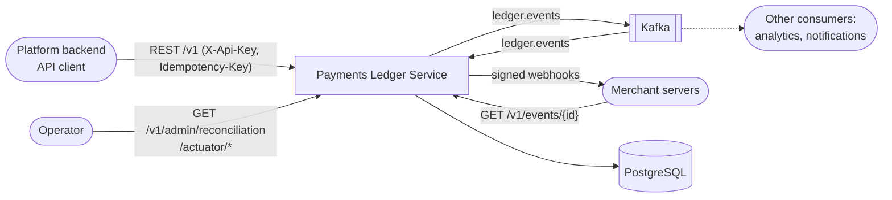

The service is the **system of record for balances**. The REST API is synchronous: a 201 means the money moved and
is committed. Everything downstream (Kafka, webhooks) is asynchronous and driven by the outbox.

## 2. Component view (packages)

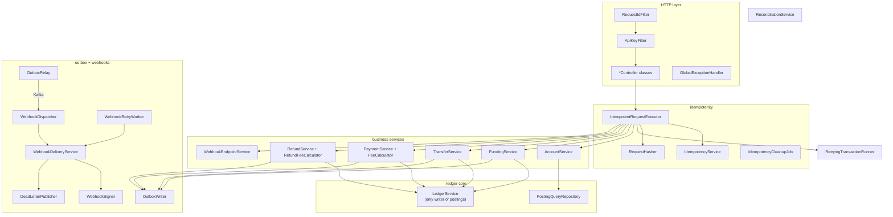

| Package | Responsibility |
|---|---|
| `config` | Typed config (`LedgerProperties`), API-key and request-id filters, Kafka topics, error handler, OpenAPI, `Clock`, `HttpClient` beans |
| `common` | `Money`, `ApiException`, error format, `GlobalExceptionHandler`, `RetryingTransactionRunner`, `TransientFailures`, metrics |
| `idempotency` | The reusable idempotency component used by every POST |
| `account` | Accounts API, entity, account-type/normal-side rules |
| `ledger` | `JournalEntry`, `Posting`, `Leg`, `LedgerService` (the only place postings are written), statement queries |
| `funding`, `transfer`, `payment`, `refund` | Business flows, each a thin layer over `LedgerService` |
| `outbox` | `OutboxWriter`, `OutboxRelay`, event envelope, `GET /v1/events/{id}` |
| `webhook` | Endpoint registration, dispatcher (Kafka consumer), retry worker, signer and verifier, DLQ |
| `reconciliation` | Invariant checks and the admin endpoint |

## 3. Data model

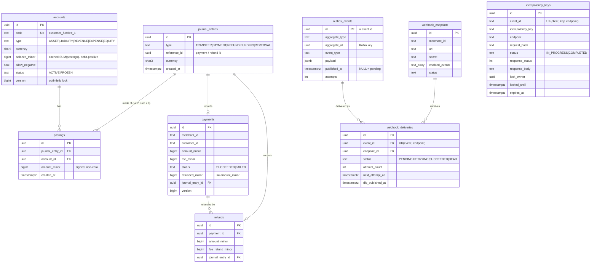

**Database-level guarantees** (from the Flyway migrations, so they hold even if the application has a bug):

| Guarantee | Mechanism |
|---|---|
| Every journal entry balances, has ≥ 2 postings, and uses one currency | `postings_must_balance`: a `DEFERRABLE INITIALLY DEFERRED` constraint trigger that runs at COMMIT |
| Ledger rows are never changed or deleted | `BEFORE UPDATE OR DELETE` triggers on `postings` and `journal_entries` raise an error |
| No zero postings | `CHECK (amount_minor <> 0)` |
| Never refund more than was paid | `CHECK (refunded_minor <= amount_minor)` |
| One idempotency record per (client, key, endpoint) | `UNIQUE` constraint, used by `INSERT ... ON CONFLICT DO NOTHING` |
| One delivery per (event, endpoint) | `UNIQUE` constraint, used by `INSERT ... ON CONFLICT DO NOTHING` |
| Statement pagination is an index scan | index `(account_id, created_at, id)` |
| Relay polling stays cheap | partial index on `outbox_events(created_at) WHERE published_at IS NULL` |

## 4. Double-entry accounting

### Sign convention

Each posting is a signed amount in minor units: **debit = positive, credit = negative**. Every journal entry's
postings sum to exactly zero. An account's stored `balance_minor` is the raw sum of its postings.

Each account type has a **normal side**, the side that makes it grow:

| Type | Normal side | Grows with | Human balance |
|---|---|---|---|
| ASSET, EXPENSE | DEBIT | debits (+) | `balance_minor` |
| LIABILITY, REVENUE, EQUITY | CREDIT | credits (−) | `−balance_minor` |

The API returns both values. `balance_minor` is the human balance (a funded wallet is positive), and
`signed_balance_minor` is the raw ledger value.

### Why a customer wallet is a LIABILITY

From the platform's point of view, money in a customer's wallet is money **the platform owes** the customer.
When $100 arrives from the bank:

```
external_settlement:USD  (ASSET)      +10000   debit:  the platform now holds cash
customer_funds:c_1       (LIABILITY)  -10000   credit: the platform now owes the customer
                                      ------
                                           0
```

Both accounts *increase* (each on its own normal side), and the entry still balances. This is why the code
expresses business intent with `Leg.increase(...)` / `Leg.decrease(...)`. `LedgerService` converts each leg to
a debit or credit only after it has locked the account and knows its type.

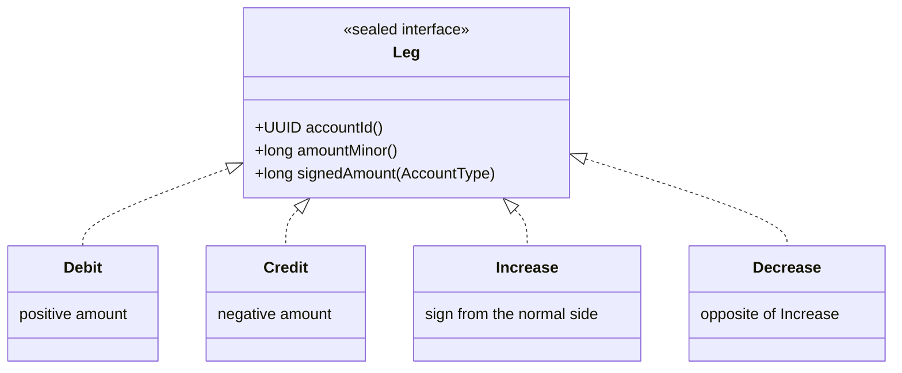

### Cached balance and immutability

- **Postings are the source of truth** and are append-only. A mistake is fixed with a new reversing entry,
  never with `UPDATE`. That preserves the full audit trail, the way an accountant never erases a line in the
  book.
- **`accounts.balance_minor` is a cache** for O(1) reads. It is updated in the *same transaction* as the
  postings. Either both commit or neither does, so the cache can never be ahead of or behind the postings.
  The reconciliation endpoint proves this by recomputing `SUM(postings)`.

### `LedgerService.post`: the only writer

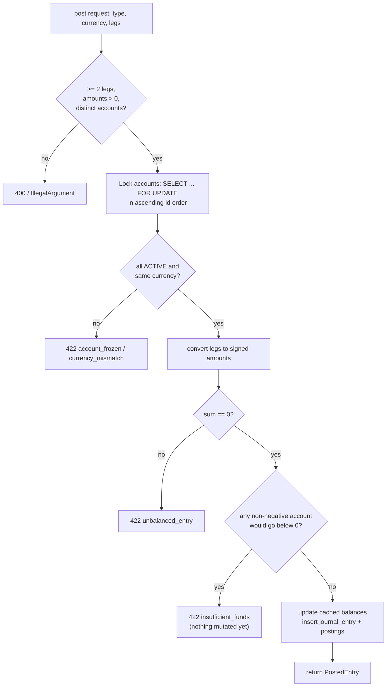

All checks run before any mutation. That's what lets `PaymentService` catch `InsufficientFundsException` and
still commit a `FAILED` payment row: no balance has been touched yet.

## 5. Money flows with exact postings

The fee rule is configurable: `fee = round_half_up(amount × 290 / 10 000) + 30`. A $10.00 payment
(1 000 cents) pays a fee of 29 + 30 = **59**.

| Flow | Postings (signed, debit +) | Sum |
|---|---|---|
| **Funding** 10 000 | `external_settlement:USD +10000`, `customer_funds:c -10000` | 0 |
| **Transfer** 2 500 wallet A → wallet B | `customer_funds:A +2500` (debit: liability shrinks), `customer_funds:B -2500` | 0 |
| **Payment** 1 000 | `customer_funds:c +1000`, `merchant_balance:m -941`, `platform_fees:USD -59` | 0 |
| **Refund** 300 of that payment | `merchant_balance:m +282`, `platform_fees:USD +18`, `customer_funds:c -300` | 0 |

### Refund fee rounding rule

The fee is refunded **proportionally on the cumulative refunded amount**:

```
feeRefundedAfter(r) = round_half_up(fee × r / amount)
feeShare(refund)    = feeRefundedAfter(already + refund) − feeRefundedAfter(already)
```

Example (amount 1 000, fee 59): refunding 300 returns `round(17.7) = 18`. Refunding the remaining 700 returns
`59 − 18 = 41`. Because the sum *telescopes*, any split of a full refund returns **exactly** the fee. Rounding each
partial refund on its own would drift by a cent or more after several partial refunds. The unit test
`randomSplitsAlwaysSumToFeeAndNeverExceedTheRefund` checks this over 1 000 random splits.

### Payment state

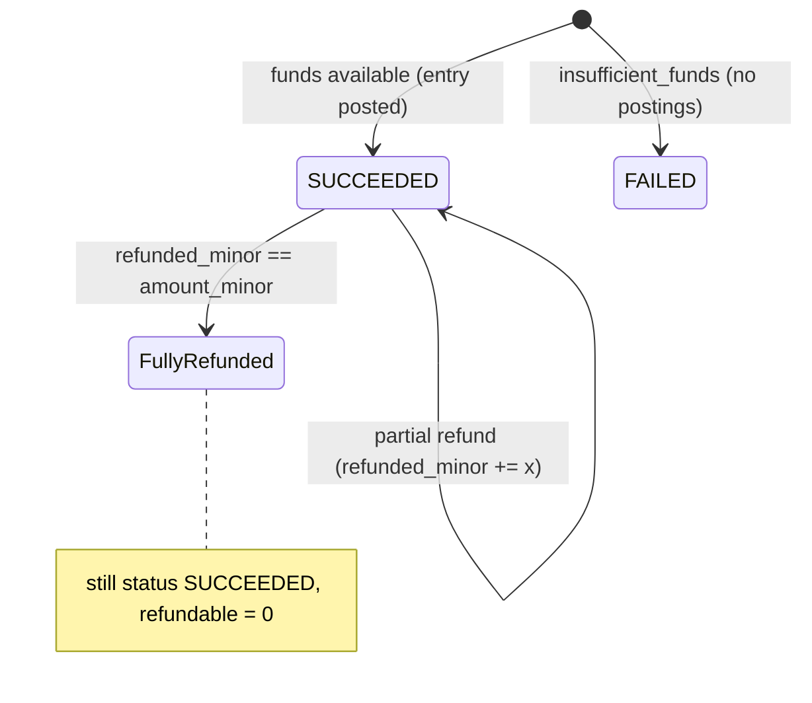

## 6. Idempotency

### The problem

A client sends `POST /v1/payments`. The network drops the response, so the client can't tell whether the payment
happened, and it retries. Without idempotency the customer is charged twice.

### Flow

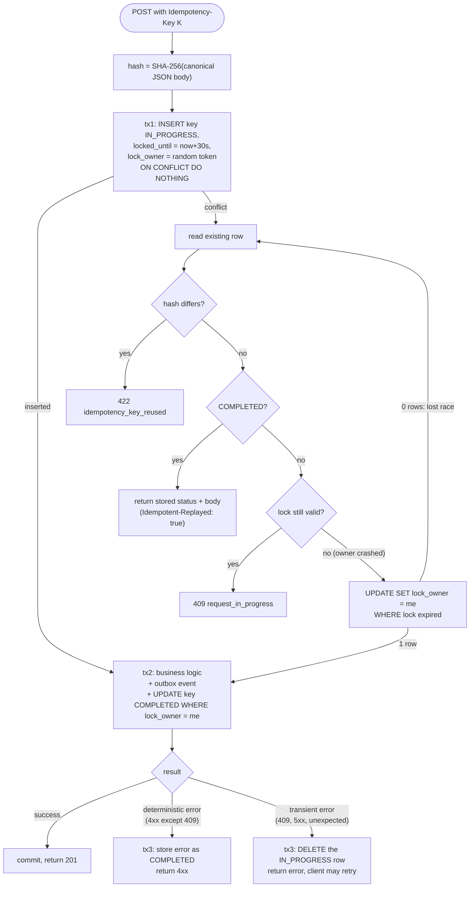

### Key state machine

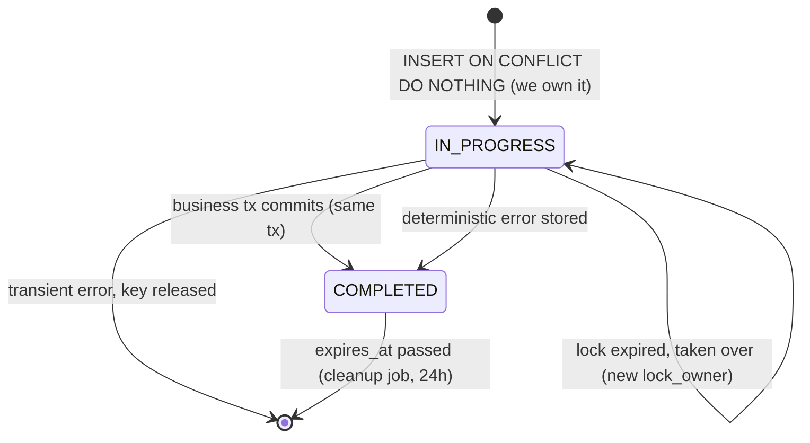

### Why each piece exists

| Piece | Reason |
|---|---|
| **Claim in its own short transaction** | The IN_PROGRESS row must be *visible* to concurrent duplicates while the business transaction runs, so they get 409 instead of running the payment a second time. |
| **Completion inside the business transaction** | Atomicity: there is no instant where money moved but the key isn't COMPLETED. If we completed the key after commit, a crash between the two would let a retry pay again. |
| **`request_hash`** | Reusing a key with a different body is a client bug. Returning the old response would silently hide it, so the service rejects it with 422. |
| **`locked_until` + takeover** | If the process dies mid-request, the key would stay IN_PROGRESS forever. After 30s another request may take over, using an atomic conditional `UPDATE`, so only one racer wins. |
| **`lock_owner` token** | A slow original request whose lock was taken over must not also complete. Its `UPDATE ... WHERE lock_owner = <its token>` matches 0 rows and its business transaction rolls back. Exactly one of them commits. |
| **Store deterministic errors** | Retrying "insufficient funds" with the same key gives the same answer, even if the customer was topped up in between. A new attempt is a new key. This matches Stripe's behaviour. |
| **Release on transient errors** | A 500 or a deadlock-after-retries says nothing about the request itself, so the client must be able to retry with the same key. |
| **Scope = (client, key, method + path)** | Two API clients can't collide on keys, and the same key on two endpoints is two different operations. |
| **`response_body TEXT`, not JSONB** | JSONB normalizes key order and whitespace. A replay must return exactly the same bytes as the first response. |
| **Plain SQL (JdbcTemplate) instead of JPA** | The design depends on single atomic statements (`ON CONFLICT`, conditional `UPDATE`). Their row counts *are* the concurrency control. |

### Concurrent duplicates

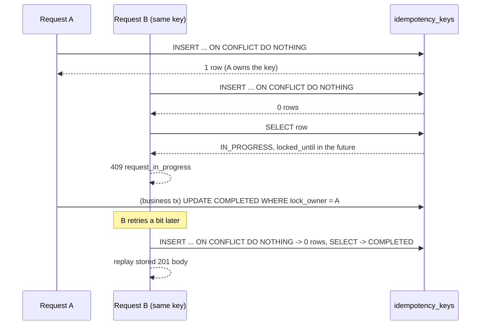

## 7. Concurrency

### Pessimistic locks for balances

A transfer reads a balance, checks it, then writes it. Two concurrent transfers out of the same wallet could both
read 100, both pass a "≥ 80" check and leave −60: the classic **lost update**. `LedgerService` therefore locks
every involved account with `SELECT ... FOR UPDATE` before reading the balance. The second transaction **waits**
until the first commits, then reads the new balance.

**Why not optimistic locking for balances?** Balance rows are *hot*: the same wallet, and above all
`platform_fees:USD`, is touched by many concurrent requests. Under optimistic locking, all but one of N
concurrent writers fail with a version conflict and redo their work, so throughput collapses as contention grows,
and a busy account can starve. Queuing on a row lock does each piece of work exactly once.

### Optimistic `@Version` for metadata

`accounts.status` (freeze/unfreeze) and `payments.refunded_minor` carry `@Version`. Hibernate turns each update
into `UPDATE ... SET ..., version = v+1 WHERE id = ? AND version = v`. If the row changed in between, 0 rows
match. Hibernate throws `OptimisticLockException`, and `RetryingTransactionRunner` retries the whole
transaction. This fits because these updates are rare and seldom concurrent, so there's no reason to hold locks
for them. Balance updates also bump `version`, so a freeze can never silently overwrite a balance written by a
concurrent transfer.

Refunds use **both**. The payment row is locked `FOR UPDATE` so two parallel refunds can't both pass the
"amount ≤ remaining" check, and `@Version` is the safety net for any code path that forgets to lock.

### Deadlock avoidance: global lock order

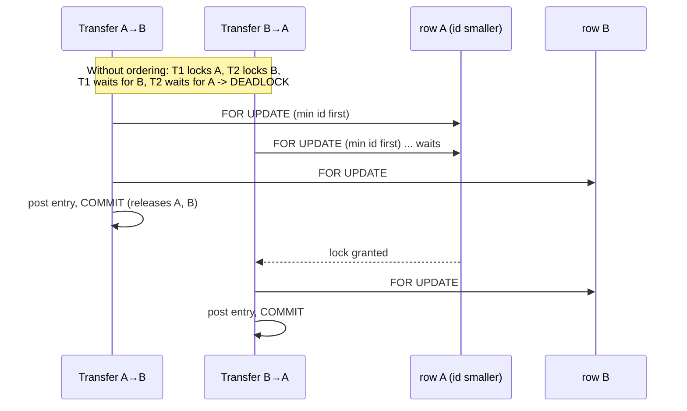

A deadlock needs a cycle in the wait-for graph. If every transaction acquires row locks in the same global order
(ascending account UUID), no cycle can form. Refunds lock the payment row first, then accounts in id order, which
is also a consistent order.

### Retries for what remains

Deadlocks can still come from places we don't control, and lock timeouts happen under extreme load.
`RetryingTransactionRunner` retries the whole transaction up to 3 times, with exponential backoff and jitter, on:

| Failure | SQLSTATE / exception |
|---|---|
| Deadlock detected | `40P01` |
| Serialization failure | `40001` |
| Lock wait timeout (`lock_timeout = 10s`, set per connection) | `55P03` |
| Optimistic lock conflict | `OptimisticLockException`, `ObjectOptimisticLockingFailureException` |

After the last retry it returns **409 `concurrent_modification`**, and the idempotency key is released so the
client can retry safely. Each retry starts a fresh persistence context, which is why
`spring.jpa.open-in-view=false`.

### Headline test

`TransferConcurrencyIntegrationTest` fires 1 000 transfers through real HTTP on 50 threads across 10 accounts. The
first 200 alternate A→B / B→A on a single hot pair. It asserts:

- only 201 or 422 responses (no deadlock, 409 or 500 leaks out);
- total money is unchanged;
- every cached balance equals the sum of its postings;
- no wallet went negative;
- the number of transfer journal entries equals the number of 201s.

## 8. Transactional outbox and Kafka

### Why not publish to Kafka directly?

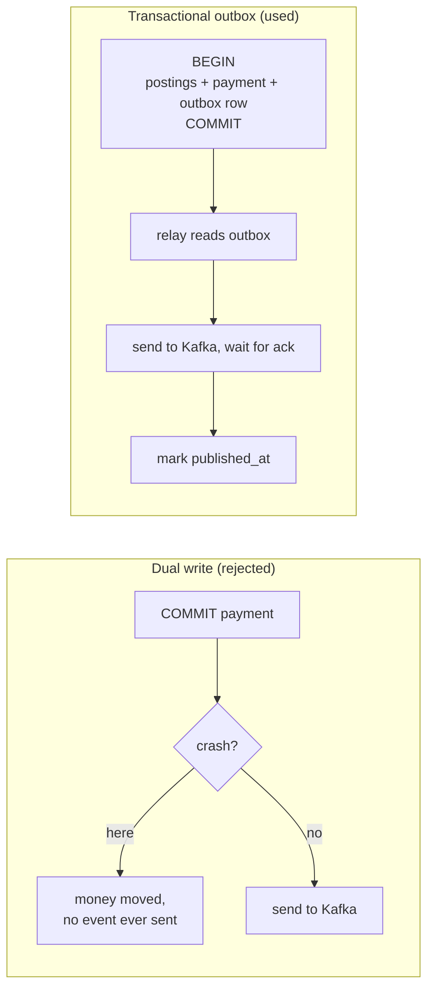

Publishing first and committing second is no better: if the commit fails, consumers react to a payment that
never happened.

### Relay

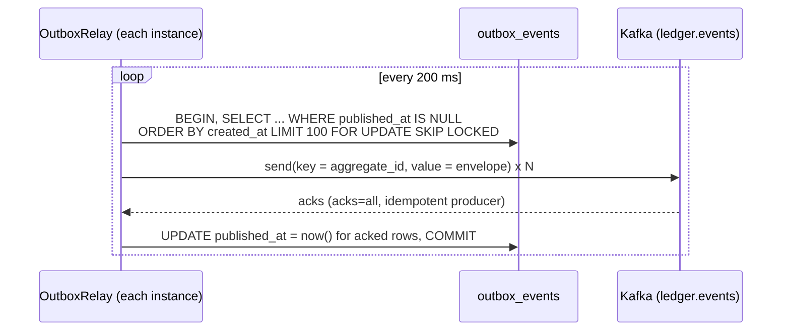

- **`SKIP LOCKED`**: a second app instance skips rows the first instance has locked instead of waiting, so relays scale
  horizontally without double-publishing a row in the normal case.
- **Key = `aggregate_id`**: Kafka orders messages per partition, and the key picks the partition. All events of one
  payment (`payment.succeeded`, then `refund.created`, because a refund's aggregate is its payment) land on the
  same partition in order.
- **Idempotent producer (`enable.idempotence=true`, `acks=all`)**: the broker drops duplicates caused by the
  producer's *own* internal retries, and `acks=all` means the write survives a broker failover.
- **Kafka down**: `max.block.ms=5000`, and the relay stops a batch at the first failed send. The rows stay unpublished,
  the API is unaffected, and the backlog drains when Kafka returns (manual demo in [RUNNING.md](RUNNING.md#8-demo-kafka-is-down-but-the-api-keeps-working)).

### Delivery guarantee: at-least-once, so consumers dedupe

If the relay crashes **after** Kafka acknowledged a batch but **before** its DB commit, those rows are still
unpublished and are sent again. The idempotent producer can't prevent this: from Kafka's point of view it's a new
send from a new producer session. So delivery is **at-least-once**, and every consumer must dedupe by the event
`id`. The webhook dispatcher does this with `UNIQUE(event_id, endpoint_id)` + `ON CONFLICT DO NOTHING`. That makes
the *effect* exactly-once even though delivery is not.

### Event envelope

```json
{
  "id": "6f1c0e4e-1d0b-4c7a-9a43-6f0f4b2a8f11",
  "type": "payment.succeeded",
  "created": 1730371200,
  "data": { "id": "…payment id…", "object": "payment", "merchant_id": "m_456", "amount_minor": 1000, "fee_minor": 59, "...": "..." }
}
```

Event types: `funding.completed`, `transfer.completed`, `payment.succeeded`, `refund.created`. Merchants can
subscribe webhooks to `payment.succeeded`, `refund.created` or `*`.

## 9. Webhooks

### End to end

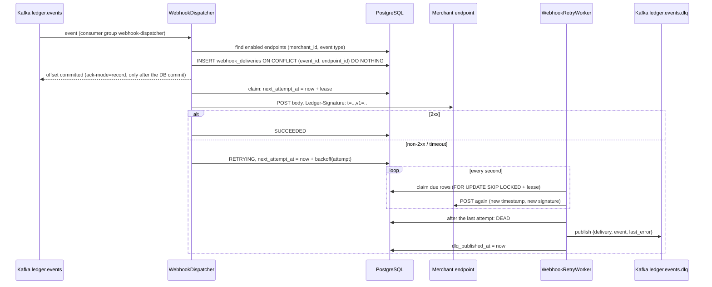

### Delivery state machine

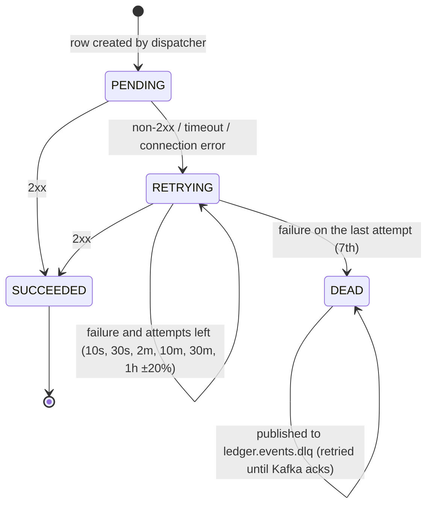

- **Leases instead of long-held locks.** A worker claims a delivery by atomically pushing `next_attempt_at` into the
  future, commits, and only then makes the slow HTTP call. It holds no DB lock during the call. If the worker dies,
  the lease expires and another worker picks the delivery up.
- **Jitter.** If a merchant was down for an hour, thousands of deliveries failed together. ±20% randomization
  spreads their retries out so they don't hit the merchant in the same second when it comes back.
- **Offsets after the DB commit.** The consumer runs with `ack-mode=record`, so the offset is committed only after the
  listener returned, which means after the delivery rows were committed. A crash before that point makes Kafka
  redeliver the record, and the unique constraint absorbs the duplicate.
- **Poison messages** (unparseable JSON) are logged and skipped. Infrastructure errors (DB down) are retried by
  `DefaultErrorHandler` with exponential backoff, without skipping.

### Signature scheme

```
Ledger-Signature: t=<unix seconds>,v1=<hex(HMAC_SHA256(secret, "<t>.<raw body>"))>
```

| Property | How |
|---|---|
| Authenticity | Only we and the merchant know the secret (32 random bytes, shown once at registration) |
| Integrity | Any change to the body changes the HMAC |
| Replay protection | The timestamp is part of the signed message, and receivers reject anything older than 5 minutes |
| Timing-attack resistance | `MessageDigest.isEqual` compares in constant time |
| Secret rotation | The verifier accepts any of several `v1=` values |

`WebhookSignatureVerifier` is a dependency-free reference implementation that merchants can copy.

## 10. Reconciliation

`GET /v1/admin/reconciliation` (admin key) recomputes everything from the postings in a single
**REPEATABLE READ, read-only** transaction. Every query sees one consistent snapshot, so concurrent transfers
can't produce false mismatches.

| Check | SQL idea |
|---|---|
| Cached balance == `SUM(postings)` per account | `LEFT JOIN postings GROUP BY account HAVING balance_minor <> SUM` |
| Every journal entry sums to 0 | `GROUP BY journal_entry_id HAVING SUM <> 0` |
| Every currency sums to 0 across the whole ledger | `JOIN accounts GROUP BY currency HAVING SUM <> 0` |

## 11. Transaction boundaries

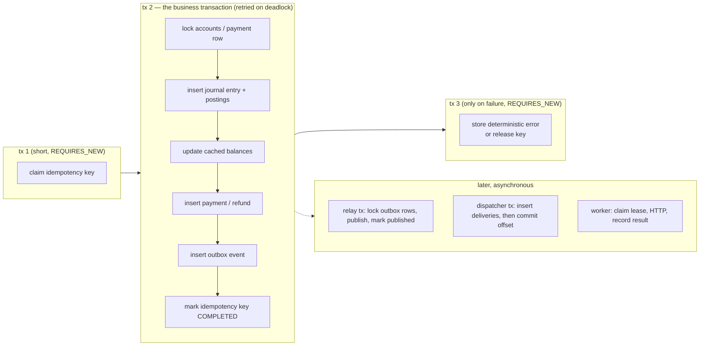

## 12. Error model

```json
{ "error": { "type": "invalid_request_error", "code": "insufficient_funds",
             "message": "Account customer_funds:c_123 has insufficient funds.",
             "param": "amount_minor", "request_id": "req_4f…" } }
```

| HTTP | `type` | Example codes | Stored for the idempotency key? |
|---|---|---|---|
| 400 | `invalid_request_error` | `parameter_missing`, `parameter_invalid`, `invalid_json`, `invalid_currency`, `missing_header`, `same_account`, `invalid_cursor`, `invalid_url` | Validation errors (`@Valid`) happen before the key is claimed, so no. Errors raised in services: yes |
| 401 | `authentication_error` | `invalid_api_key` | no (rejected before the controller) |
| 403 | `permission_error` | `admin_required` | no |
| 404 | `invalid_request_error` | `account_not_found`, `payment_not_found`, `customer_account_not_found` | yes |
| 409 | `idempotency_error` / `conflict_error` | `request_in_progress`, `concurrent_modification`, `idempotency_lock_lost` | **no**: the key is released so the client can retry |
| 422 | `invalid_request_error` / `idempotency_error` | `insufficient_funds`, `refund_exceeds_payment`, `payment_fully_refunded`, `account_frozen`, `currency_mismatch`, `incompatible_accounts`, `amount_too_small`, `idempotency_key_reused` | yes (except `idempotency_key_reused`, which is never run) |
| 500 | `api_error` | `internal_error` | **no**: the key is released |

## 13. Deployment view

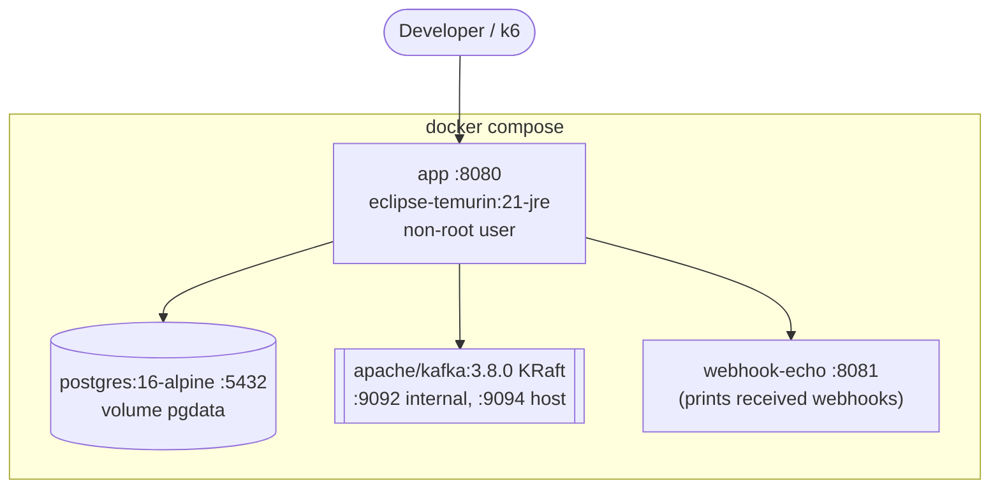

The multi-stage `Dockerfile` builds the jar in `gradle:8.10.2-jdk21` and ships only the JRE plus the jar. To
scale horizontally, run N `app` replicas behind a load balancer. Relays and retry workers coordinate through
`SKIP LOCKED` and leases, and the Kafka consumer group spreads partitions across replicas.

## 14. Deliberate deviations from the original spec

| Spec said | Built | Why |
|---|---|---|
| Transfer postings "from = −amount, to = +amount" | from = **decrease**, to = **increase** on each account's normal side. For two LIABILITY wallets that's from **+** (debit), to **−** (credit) | With debit-positive signs, "−amount" on a liability *increases* it, which would move money the wrong way. Accounts with different normal sides are rejected (`incompatible_accounts`). |
| Payment postings listed as `customer −amount, merchant +(amount−fee), fees +fee` | Same business meaning, stored debit-positive: customer **+1000**, merchant **−941**, fees **−59** | Consistent sign convention across all flows. The API's `balance_minor` still shows positive wallet balances. |
| `platform_fees`, `external_settlement` | `platform_fees:<CUR>`, `external_settlement:<CUR>` (USD, EUR, GBP, INR seeded) | An account has exactly one currency, so each currency needs its own system accounts. |
| `response_body JSONB` | `TEXT` | Byte-identical replays (JSONB reorders keys). |
| — | added `lock_owner` to `idempotency_keys` | Prevents a slow, taken-over request from also completing. |
| — | added `POST /v1/accounts/{id}/freeze` and `/unfreeze` | Exercises the `@Version` optimistic-locking path and the `account_frozen` rule. |
| `idempotency/` "entity, repository" | `IdempotencyService` with JdbcTemplate | Atomic single statements (`ON CONFLICT`, conditional `UPDATE`) are the concurrency control. JPA would hide them. |
