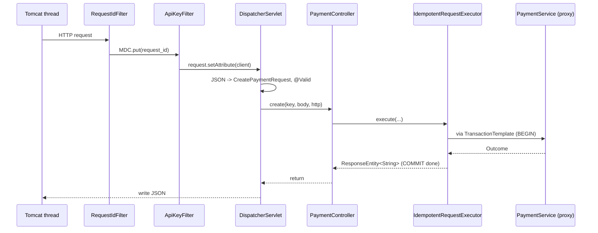

# Java and Spring Boot for a Python (Django / FastAPI / Celery) developer

Every concept used in this codebase, mapped to what you already know.

## Project layout: Spring Boot vs Django

```
payments-ledger/                       Django equivalent
├── build.gradle.kts                   pyproject.toml / requirements.txt (+ the build steps)
├── settings.gradle.kts                project name
├── gradlew                            pinned build tool (like a committed poetry/pip-tools setup)
├── src/main/java/com/omkar/ledger/    your Django project package
│   ├── LedgerApplication.java         manage.py + wsgi.py (main entry point)
│   ├── config/                        settings.py + middleware
│   ├── account/  payment/  ...        Django "apps": one package per feature
│   │   ├── *Controller.java           views.py (DRF ViewSet / APIView)
│   │   ├── *Service.java              services.py (business logic)
│   │   ├── *Repository.java           Model.objects (Manager / QuerySet)
│   │   ├── Account.java (@Entity)     models.py
│   │   └── dto/*.java (records)       serializers.py / pydantic models
├── src/main/resources/
│   ├── application.yml                settings.py values (with env-var overrides)
│   └── db/migration/V1__*.sql         migrations/0001_*.py (but plain SQL, run by Flyway)
└── src/test/java/...                  tests/ (pytest)
```

Packages are organized **by feature** (account, payment, refund ...), like Django apps, not by layer.

## Concept map

| Java / Spring | Python equivalent | Where in this repo |
|---|---|---|
| `@SpringBootApplication` + `main` | `manage.py runserver` + `INSTALLED_APPS` discovery | `LedgerApplication` |
| `@Component`, `@Service`, `@Repository` | a module-level singleton the framework creates and injects for you | every service |
| Constructor injection | FastAPI `Depends(...)`, but resolved once at startup | every constructor taking other beans |
| `@Bean` method in `@Configuration` | a factory function registering a singleton | `AppConfig` (Clock, FeeCalculator, HttpClient) |
| `application.yml` + `@ConfigurationProperties` | `settings.py` + pydantic `BaseSettings` (typed, env overrides) | `LedgerProperties` |
| `@RestController` + `@PostMapping` | DRF `APIView.post` / FastAPI `@app.post` | `*Controller` |
| `@RequestBody @Valid Dto` | pydantic model parameter / DRF serializer `is_valid(raise_exception=True)` | controllers |
| `record CreatePaymentRequest(...)` | `@dataclass(frozen=True)` / pydantic `BaseModel` | `dto/` packages |
| Jakarta Validation (`@NotNull`, `@Positive`) | pydantic `Field(gt=0)` | DTOs |
| `@RestControllerAdvice` + `@ExceptionHandler` | DRF `EXCEPTION_HANDLER` / FastAPI `@app.exception_handler` | `GlobalExceptionHandler` |
| `OncePerRequestFilter` | Django middleware | `RequestIdFilter`, `ApiKeyFilter` |
| SLF4J `MDC` | `contextvars` read by a `logging.Filter` | request id in every log line |
| `@Entity` (JPA/Hibernate) | Django `models.Model` | `Account`, `Payment`, ... |
| `JpaRepository<Account, UUID>` | `Account.objects` | `AccountRepository` |
| `@Query("select a.id from Account a where ...")` | `.values_list("id", flat=True).filter(...)` | `AccountRepository` |
| `@Lock(PESSIMISTIC_WRITE)` / `em.find(..., PESSIMISTIC_WRITE)` | `.select_for_update()` | `PaymentRepository`, `LedgerService` |
| `@Version` | no built-in; like `django-concurrency` / a manual `version` column + `filter(version=v).update(...)` | `Account`, `Payment` |
| `@Transactional` | `@transaction.atomic` | services |
| `TransactionTemplate.execute(...)` | `with transaction.atomic():` | `RetryingTransactionRunner` |
| `Propagation.REQUIRES_NEW` | `atomic()` on a **separate connection**: a real independent transaction, not a savepoint | `IdempotencyService` |
| `Propagation.MANDATORY` | "assert we're inside `atomic()`" (`connection.in_atomic_block`) | `LedgerService.post`, `OutboxWriter.write` |
| `JdbcTemplate` | `connection.cursor().execute(sql, params)` | idempotency, outbox, deliveries |
| Flyway `V1__x.sql` | Django migrations, but hand-written SQL, applied in version order, checksummed | `db/migration` |
| `@Scheduled(fixedDelay=...)` | Celery beat periodic task | `OutboxRelay`, `WebhookRetryWorker`, cleanup |
| `@KafkaListener` | a Celery worker / `confluent_kafka` consumer loop | `WebhookDispatcher` |
| `KafkaTemplate.send(...)` | `producer.produce(...)` | `OutboxRelay` |
| Micrometer `Counter` | `prometheus_client.Counter` | `LedgerMetrics` |
| Actuator `/actuator/health` | `django-health-check` | |
| JUnit 5 `@Test` + AssertJ `assertThat` | `pytest` + plain `assert` | `src/test` |
| Testcontainers | `testcontainers-python` / `pytest-docker` | `IntegrationTestBase` |
| Awaitility `await().until(...)` | a polling helper / `tenacity` in tests | async tests |
| `TestRestTemplate` | `django.test.Client` / FastAPI `TestClient`, but over a real socket | `LedgerApi` |

## Language features used

### `record`: immutable data classes

```java
public record Money(long amountMinor, String currency) { }
```

Like `@dataclass(frozen=True)`. You get the constructor, accessors (`amountMinor()`, with no `get` prefix),
`equals`, `hashCode` and `toString` for free. A *compact constructor* (`public Money { ... }`) is where
validation goes, like `__post_init__`.

### `sealed interface`: a closed set of variants

```java
public sealed interface Outcome<T> {
    record Success<T>(T body) implements Outcome<T> {}
    record Failure<T>(ApiException error) implements Outcome<T> {}
}

switch (outcome) {
    case Outcome.Success<?> s -> ...;
    case Outcome.Failure<?> f -> ...;   // the compiler checks that all cases are covered
}
```

Like a `Union[Success, Failure]` with `match`, except that the compiler *refuses* to build if you forget a case.
It's used for `Outcome`, `IdempotencyClaim` and `Leg`.

### `var`

`var account = new Account(...)` infers the type, like any Python assignment. The variable is still statically
typed.

### Text blocks

`"""` multi-line strings, used for SQL. Like Python triple-quoted strings.

### Checked vs unchecked exceptions

`IOException` is *checked*: Java forces you to catch it or declare it. `RuntimeException` (and our `ApiException`)
is *unchecked*, which is the Python model. **`@Transactional` rolls back on unchecked exceptions by default**,
which is why business errors extend `RuntimeException`.

### `long` and `Math.addExact`

Python ints never overflow. Java's `long` wraps around silently at ±9.2 × 10¹⁸, so in a ledger we use
`Math.addExact` / `multiplyExact`, which throw `ArithmeticException` instead. Money is **never**
`double`/`float`, for the same reason you'd never use Python `float` for money (use `Decimal` or integer cents).

### `Optional<T>`

Like returning `T | None`, but explicit: `repo.findById(id).orElseThrow(() -> notFound(...))` is
`get_object_or_404`.

### Lambdas and method references

`() -> service.create(body)` is a `lambda: service.create(body)`. `PaymentResponse::from` is like passing the function
object `PaymentResponse.from_`.

## Spring pitfalls this codebase deliberately avoids

| Pitfall | What we do |
|---|---|
| **Open-Session-In-View** (on by default) keeps one Hibernate session for the whole request, so a retried transaction would see stale entities | `spring.jpa.open-in-view: false` |
| **Self-invocation**: calling a `@Transactional` method from the same class skips the proxy, so there's no transaction | Transactional boundaries are between beans (controller → executor → service → LedgerService) |
| An exception crossing a `@Transactional` method silently marks the outer transaction rollback-only | `LedgerService.post` declares `noRollbackFor = InsufficientFundsException.class`, so `PaymentService` can catch it and still commit the FAILED payment |
| Loading an entity before locking it, so the "locked" read is served from a stale cached copy | Services resolve ids/types with scalar queries. Only `LedgerService` loads accounts, with `FOR UPDATE`. |
| `float`/`double` money | `long` minor units everywhere, `BigDecimal` only for intermediate rounding |
| Hibernate generating the schema | `ddl-auto: none`. Flyway SQL is the source of truth. |

## How a request flows through Spring



A "proxy" is a generated wrapper class around your bean. It's how `@Transactional` works, like a decorator that
Spring applies for you. It intercepts the call, opens the transaction, calls the real method, and commits or rolls back.
