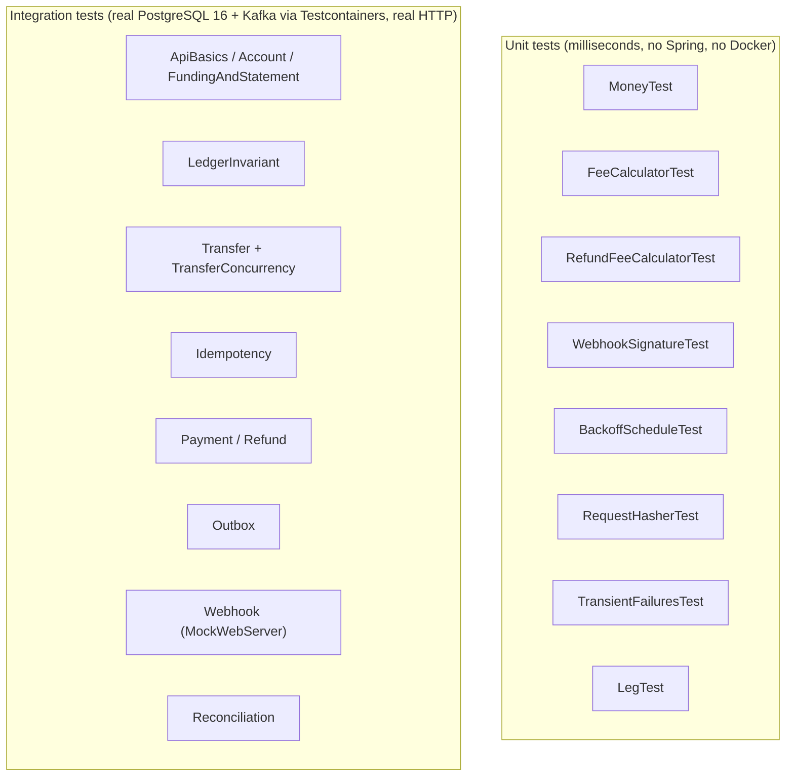

# Testing

## Strategy



**No H2, no mocked database.** The behaviour under test depends on PostgreSQL itself: `FOR UPDATE`, `SKIP LOCKED`,
`ON CONFLICT`, deferred constraint triggers and `REPEATABLE READ`. An in-memory substitute would test a
different database.

### How the integration setup works (`support/IntegrationTestBase`)

- The PostgreSQL and Kafka containers are `static` and start once per JVM (`Startables.deepStart`). They are
  shared by every test class.
- `@DynamicPropertySource` points `spring.datasource.*` and `spring.kafka.bootstrap-servers` at the containers.
- Every test class uses the same configuration, so Spring builds **one** application context and caches it.
- `webEnvironment = RANDOM_PORT` starts the real Tomcat, and tests call it over HTTP with `TestRestTemplate`
  (wrapped by `LedgerApi`).
- Tests isolate themselves with unique ids (`TestIds.unique(...)`) instead of truncating tables. That's also why
  the global reconciliation check can run at any point.
- `application-test.yml` shortens the timings: relay every 100 ms, webhook retries 200 ms × 3, no jitter, and the
  retry worker polls every 100 ms.

> **Python analogy:** this is `pytest` with a session-scoped fixture that starts Postgres/Kafka in Docker
> (as with `pytest-docker` or `testcontainers-python`), plus `TestClient(app)` hitting the real ASGI app.

## What each test proves

| Test class | Proves |
|---|---|
| `MoneyTest` | exact arithmetic, overflow throws (`Math.addExact`), half-up percentage rounding, `Long.MAX_VALUE` edge case |
| `FeeCalculatorTest` | 2.9% + 30 fee, smallest valid amount (32), rejection when amount ≤ fee, huge amounts |
| `RefundFeeCalculatorTest` | cumulative proportional rounding; 1 000 random split sequences each return **exactly** the fee; 1-unit refunds |
| `WebhookSignatureTest` | valid signature verifies; tampered body, wrong secret, expired or future timestamp, malformed header all fail; secret rotation; RFC 4231 HMAC vector |
| `BackoffScheduleTest` | 10s→1h schedule, dead after the last delay, jitter bounds |
| `RequestHasherTest` | key order doesn't change the hash; a record and the equivalent map hash the same |
| `TransientFailuresTest` | deadlock/serialization/lock-timeout/optimistic conflicts are retried; business and integrity errors are not |
| `LegTest` | increase/decrease → debit/credit for each account type; payment and funding legs balance |
| `ApiBasicsIntegrationTest` | health, OpenAPI, 401/403, request-id propagation, 404 format, missing or too-long Idempotency-Key, malformed JSON, unknown fields, snake_case `param` |
| `AccountIntegrationTest` | create/get, case-insensitive enums, duplicate code 422, invalid currency/code 400, 404, freeze blocks money movement, `@Version` increments |
| `FundingAndStatementIntegrationTest` | funding postings, cursor pagination (newest first, no gaps or duplicates, `has_more`), invalid cursor, limits, funding rules |
| `LedgerInvariantIntegrationTest` | service rejects unbalanced entries; `MANDATORY` tx; **DB trigger rejects unbalanced, single-posting and mixed-currency entries at commit**; append-only triggers; zero-amount check |
| `TransferIntegrationTest` | happy path with posting signs, outbox event, insufficient funds (nothing moves), exact balance, allow_negative, every error code |
| `TransferConcurrencyIntegrationTest` | **1 000 parallel transfers** (see below) |
| `IdempotencyIntegrationTest` | identical replay + header; key-order-insensitive; different body → 422; scope per endpoint/client; **10 concurrent same-key requests → exactly 1 payment**; stored business errors; active lock → 409; **expired lock takeover**; transient errors release the key; 409s not stored; 404s stored; cleanup |
| `PaymentIntegrationTest` | fee and 3 balanced postings, outbox payload, FAILED payment on insufficient funds (no postings), 404s, amount_too_small, unsupported currency, validation |
| `RefundIntegrationTest` | partial refunds add up (fee 18 + 41 = 59), full refund by default, over-refund, failed/unknown payments, GET, event ordering key, **10 parallel refunds of 300 on 1 000 → exactly 3 succeed** |
| `OutboxIntegrationTest` | event rolled back with the transaction; committed with it; `MANDATORY`; failed transfer writes no event; **relay publishes to Kafka with key = aggregate id and marks the row published**; `GET /v1/events/{id}` |
| `WebhookIntegrationTest` | registration and validation; **correctly signed delivery** (verified with `WebhookSignatureVerifier`); wrong secret fails; 500, 503, 200 → succeeds on attempt 3; **always 500 → DEAD after 4 attempts and a message on `ledger.events.dlq`**; **a replayed Kafka message creates no duplicate delivery**; event-type filtering |
| `ReconciliationIntegrationTest` | balanced after mixed activity; detects an artificially drifted cached balance |

## The concurrency test

`TransferConcurrencyIntegrationTest.thousandParallelTransfersKeepTheLedgerConsistent`:

1. Creates 10 wallets and funds each with 100 000.
2. Builds 1 000 transfers. The first 200 alternate A→B / B→A on one pair (a deadlock magnet), and the rest use random
   pairs with amounts from 1 to 5 000. The seed is fixed, so runs are reproducible.
3. Releases all 1 000 at once through a `CountDownLatch` on a 50-thread pool, over real HTTP.
4. Asserts:
   - only `201` or `422` (no deadlock, 409 or 500 leaks out);
   - `Σ balances` is unchanged (10 × 100 000);
   - for every account, cached balance == `SUM(postings)`;
   - no wallet is negative;
   - number of TRANSFER journal entries == number of 201s.
5. Prints the result and writes it to `build/concurrency-test-result.txt`, for example:

```
Concurrency test: 1000 transfers, 50 threads, 10 accounts
  succeeded=<n> rejected(insufficient_funds)=<n> statuses={201=<n>, 422=<n>}
  elapsed=<ms> ms throughput=<x> transfers/s
```

(The `<n>` values are placeholders. Your run produces the real numbers.)

Note that this throughput includes the full HTTP stack, idempotency claims, the outbox insert and Testcontainers
networking on your laptop. It's an honest end-to-end figure, not a database microbenchmark.

## Recording results

Fill in the README's *Measured results* table only from real runs:

```bash
./gradlew clean test
cat build/concurrency-test-result.txt                          # concurrency numbers
open build/reports/tests/test/index.html                       # number of tests, pass/fail
open build/reports/jacoco/test/html/index.html                 # coverage: use the "Total" row, "Line" or "Instr." column
```

Copy the total test count (and the number that passed) from the top of the test report. Copy coverage from the
*Total* row. Write down which counter you report (instructions, lines or branches).

For k6, see [RUNNING.md §7](RUNNING.md#7-run-the-load-test-k6).

## Adding a test

- **Unit test:** a plain JUnit class under `src/test/java/...`, with no annotations beyond `@Test`.
- **Integration test:** `class MyIT extends IntegrationTestBase`. Use `api` (the `LedgerApi` helper),
  `jdbc` and `objectMapper`, generate unique ids with `TestIds.unique("prefix")`, and use Awaitility (`await()`)
  for anything asynchronous (relay, dispatcher, retries). Never use `Thread.sleep`.
